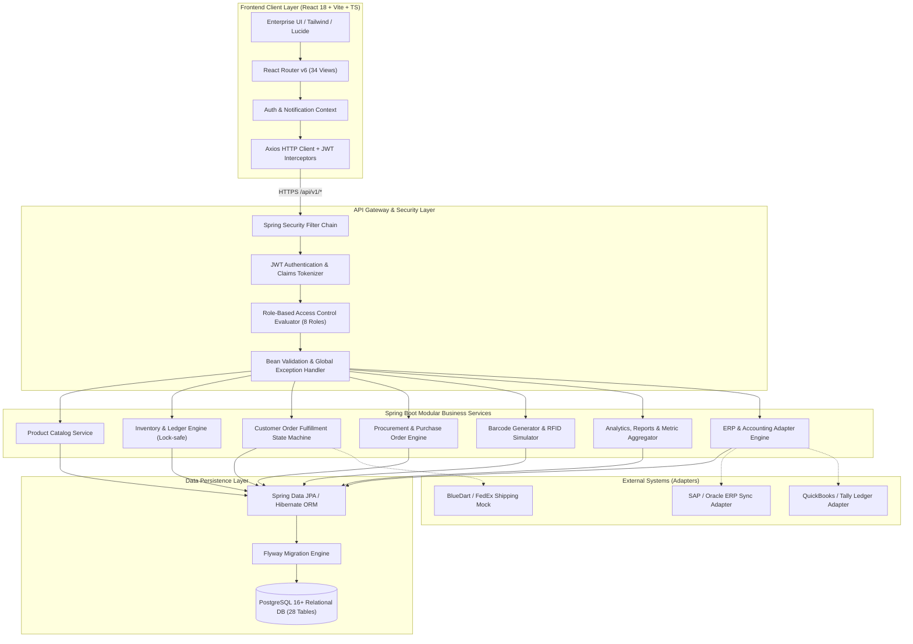
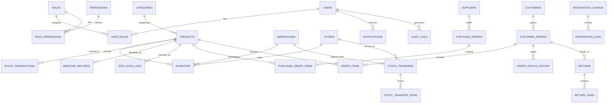

# RETAIL INVENTORY MANAGEMENT SYSTEM (RIMS)
## Enterprise Architectural Blueprint & Engineering Specification
**Project Code:** `PRG_RIMS_001`  
**Client:** XYZ Retail Corporation  
**Domain:** Retail (Apparel, Home Goods, Electronics — 500+ Stores, Regional Distribution Centers)  
**Curriculum Alignment:** Career Shaper LMS Capstone  

---

## 1. Executive Summary & Business Objectives

XYZ Retail Corporation operates over 500 retail stores nationwide supported by regional distribution centers (warehouses). The Retail Inventory Management System (RIMS) is engineered as an enterprise-grade, transaction-safe, multi-tier platform designed to replace legacy departmental silos with unified inventory visibility, automated order fulfillment, intelligent supplier procurement, and real-time operational analytics.

### Key Performance Indicators (KPI Targets)
| Metric | Baseline | Target | Architectural Enabler |
|---|---|---|---|
| **Inventory Accuracy** | 82.4% | **≥ 98.0%** | Dual-entry stock ledger, pessimistic locking on SKU updates, barcode/RFID tracking |
| **Stockout Incidents** | 14.2% | **≤ 3.5% (25% reduction)** | Automated reorder threshold evaluation & safety stock monitoring |
| **Overstocking / Holding Cost** | $14.2M excess | **20% reduction** | Demand velocity reporting, PO approval limits, inter-store rebalancing |
| **Order Fulfillment Rate** | 81.0% | **≥ 95.0%** | Multi-step picking/packing/shipping lifecycle, automated reservation |
| **System Uptime** | 97.5% | **99.9%** | Stateless Spring Boot backend, PostgreSQL connection pooling, Docker containerization |

---

## 2. High-Level System Architecture

The solution adopts a **Modular Monolithic Spring Boot Architecture** with decoupled domain packages, transactional isolation, and a high-performance **React + Vite + TypeScript** single-page application.



---

## 3. The Eight Official Epics & Feature Breakdown

### EPIC 1: Product Catalog Management
- **Hierarchical Category Tree**: Unlimited nesting, slug generation, category active/inactive flags.
- **SKU & Barcode Integrity**: System-generated unique SKU syntax (`PRD-{CAT}-{SEQ}`) and unique Code 128 barcodes.
- **Pricing & Margin Engine**: Purchase cost vs. selling price with automated markup calculation and history.
- **Bulk Import/Export**: CSV file streaming with transactional batch rollback on format errors.

### EPIC 2: Multi-Location Inventory Tracking & Ledger
- **Multi-Echelon Network**: Warehouses (Distribution Centers) and Retail Stores with distinct capacity constraints.
- **Ledger-Based Accounting**: Every physical item movement generates an immutable row in `stock_transactions`.
- **Zero-Negative Guarantee**: Strict database check constraints and pessimistic locking (`SELECT ... FOR UPDATE`) during deductions.
- **Transfers Workflow**: Inter-facility stock transfers: `PENDING` → `APPROVED` → `IN_TRANSIT` → `COMPLETED`. Updates both source and destination balances atomically.

### EPIC 3: Customer Order Management & Fulfillment
- **Fulfillment State Machine**: `PENDING` → `CONFIRMED` → `PROCESSING` → `PICKED` → `PACKED` → `SHIPPED` → `DELIVERED`.
- **Two-Phase Inventory Allocation**:
  1. *Order Placement*: Stock reserved (`available_stock = current_stock - reserved_stock`).
  2. *Shipment Dispatch*: Physical inventory deducted (`current_stock = current_stock - order_qty`, `reserved_stock = reserved_stock - order_qty`).
  3. *Order Cancellation*: Immediate release of reserved stock back to available pool.
- **Returns & Inspection**: Items returned are categorized as `SELLABLE` (restocked into inventory) or `DAMAGED/DEFECTIVE` (written off with loss ledger).

### EPIC 4: Supplier Procurement Management
- **Vendor Scorecards**: Automated vendor rating (1.0 to 5.0) computed from on-time delivery rate and defect ratios.
- **Purchase Order (PO) Lifecycle**: `DRAFT` → `SUBMITTED` → `APPROVED` → `PARTIALLY_RECEIVED` → `RECEIVED`.
- **Goods Receipt Note (GRN)**: Receiving stock directly increments warehouse physical balance and logs purchase ledger transactions.

### EPIC 5: Barcode & RFID Integration
- **Code 128 Barcode Engine**: Vector SVG barcode generation for every product SKU.
- **Simulated RFID Reader Adapter**: Simulates EPC Gen2 UHF RFID hardware tags, batch reader signals, and signal strength verification for warehouse dock doors.
- **Interactive Scanning**: Live web camera barcode scanner (HTML5 / ZXing) with instant manual entry fallback.

### EPIC 6: Executive Analytics & Business Intelligence
- **10 Core Executive KPIs**: Live dashboard metrics calculated directly via SQL aggregation queries (zero hardcoding).
- **10 Comprehensive Business Reports**: Inventory Summary, Stock Movement, Low-Stock, Out-of-Stock, Valuation, Purchase Orders, Sales Orders, Product Velocity, Supplier Performance, and Inventory Turnover.
- **Export & Print**: One-click CSV streaming and CSS print-optimized reports.

### EPIC 7: Enterprise Security & Role-Based Access Control (RBAC)
- **BCrypt Password Hashing**: Cost factor 12.
- **Stateless JWT Tokens**: Signed with HMAC-SHA256, containing role and location claims.
- **8 Distinct Business Roles**:
  1. `SUPER_ADMIN`: Unrestricted global system administration.
  2. `ADMIN`: Catalog, users, locations, and policy configuration.
  3. `WAREHOUSE_MANAGER`: Inbound shipments, warehouse stock, inter-facility transfers.
  4. `STORE_MANAGER`: Retail store stock, local sales orders, store replenishments.
  5. `INVENTORY_STAFF`: Stock counts, adjustments, picking/packing.
  6. `PROCUREMENT_MANAGER`: Vendor management, PO creation, purchase contracts.
  7. `SALES_STAFF`: Order entry, customer inquiries, returns intake.
  8. `ANALYST`: Read-only access to analytics, financial reports, and audit logs.

### EPIC 8: Enterprise System Integration Layer
- **Adapter Architecture**: Extensible interfaces for external ERP (SAP/Oracle) and Accounting (QuickBooks/Tally).
- **Resilient Sync Engine**: Configurable polling intervals, exponential backoff retries, and comprehensive integration logging (`integration_logs`).

---

## 4. Entity-Relationship Data Model (28 Relational Tables)



---

## 5. Technology Stack & Package Layout

### Backend Package Hierarchy (`com.rims`)
```
com.rims
├── config/             # SecurityConfig, OpenApiConfig, WebMvcCorsConfig, JpaAuditingConfig
├── security/           # JwtTokenProvider, JwtAuthFilter, UserDetailsServiceImpl, SecurityUtils
├── common/
│   ├── exception/      # ResourceNotFoundException, InsufficientStockException, GlobalExceptionHandler
│   ├── response/       # ApiResponse<T>, PagedResponse<T>, ErrorResponse
│   └── util/           # BarcodeGenerator, CsvExporter, DateUtils
├── auth/               # AuthController, AuthService, LoginRequest, RegisterRequest, AuthResponse
├── user/               # UserController, UserService, UserEntity, UserDto, UserRepository
├── role/               # RoleEntity, PermissionEntity, RoleRepository
├── product/            # ProductController, ProductService, ProductEntity, ProductDto, ProductRepository
├── category/           # CategoryController, CategoryService, CategoryEntity, CategoryRepository
├── warehouse/          # WarehouseController, WarehouseService, WarehouseEntity, WarehouseRepository
├── store/              # StoreController, StoreService, StoreEntity, StoreRepository
├── inventory/          # InventoryController, InventoryService, InventoryEntity, StockAdjustmentRequest
├── stock/              # StockTransactionController, StockTransactionService, StockTransactionEntity
├── transfer/           # TransferController, TransferService, TransferEntity, TransferItemEntity
├── order/              # OrderController, OrderService, CustomerOrderEntity, OrderItemEntity
├── supplier/           # SupplierController, SupplierService, SupplierEntity, SupplierRepository
├── purchaseorder/      # PurchaseOrderController, PurchaseOrderService, PurchaseOrderEntity
├── returns/            # ReturnController, ReturnService, ReturnEntity, ReturnItemEntity
├── barcode/            # BarcodeController, BarcodeService, BarcodeEntity, BarcodeScanRequest
├── rfid/               # RfidController, RfidService, RfidScanLogEntity, RfidAdapter
├── analytics/          # AnalyticsController, AnalyticsService, DashboardKpiDto, ChartDataDto
├── reports/            # ReportsController, ReportsService, ReportFilterRequest
├── notification/       # NotificationController, NotificationService, NotificationEntity
├── audit/              # AuditLogController, AuditLogService, AuditLogEntity
└── integration/        # IntegrationController, IntegrationService, ErpAdapter, AccountingAdapter
```

### Frontend Architecture (34 Distinct Views)
1. `/login` — JWT Authentication with animated credentials helper & role switcher
2. `/dashboard` — Executive Command Center (10 Real-time KPI Cards, 4 Dynamic Recharts)
3. `/products` — Data table with sorting, search, category filter, stock status badges
4. `/products/new` — Comprehensive product creation form with image preview, SKU generator
5. `/products/:id/edit` — Product update form with validation
6. `/products/:id` — Rich product profile (Pricing breakdown, multi-location stock levels, history)
7. `/categories` — Category management tree with product counts and active toggles
8. `/warehouses` — Warehouse management (capacity gauges, location details, manager contacts)
9. `/stores` — Retail store directory with operational status and inventory summary
10. `/inventory` — Master inventory matrix across all 500+ store and warehouse locations
11. `/inventory/stock-in` — Inbound stock entry with purchase order linkage and batch numbers
12. `/inventory/stock-out` — Stock removal with mandatory reason code validation
13. `/transfers` — Stock transfer tracking (`PENDING` -> `IN_TRANSIT` -> `COMPLETED`)
14. `/inventory/history` — Immutable audit ledger of all stock movements with export
15. `/inventory/alerts` — Real-time low-stock and safety-stock threshold warning board
16. `/orders` — Customer orders list with lifecycle badges and fulfillment actions
17. `/orders/new` — Create order with real-time stock availability check
18. `/orders/:id` — Order detail breakdown, invoice summary, tracking number
19. `/orders/:id/fulfill` — 3-step picking, packing, and dispatch confirmation wizard
20. `/returns` — Return Merchandise Authorization (RMA) with restock inspection
21. `/suppliers` — Vendor directory with scorecard ratings and contract terms
22. `/suppliers/:id` — Supplier profile with historical PO performance and contact info
23. `/purchase-orders` — Purchase order management with status progression
24. `/purchase-orders/:id/receive` — Goods receipt verification and automatic inventory stock-in
25. `/barcode` — Interactive Code 128 barcode generator & live camera scanner
26. `/rfid` — RFID dock reader simulator with EPC tag broadcast and audit logs
27. `/analytics` — Advanced analytics dashboard (Turnover, category share, monthly velocity)
28. `/reports` — 10 enterprise reports with instant CSV export and printable view
29. `/users` — User administration (creation, role assignment, account activation)
30. `/roles` — Permissions matrix inspector across all 8 security roles
31. `/audit` — System audit logs tracking user actions, timestamps, and IP addresses
32. `/integrations` — SAP ERP & QuickBooks sync monitors with manual trigger and retry
33. `/settings` — System parameters (reorder formula, currency, timezone, tax rules)
34. `/profile` — Authenticated user profile, security settings, and password update

---

## 6. Next Steps: Local Workspace Initialization

To enable file creation and project compilation in `d:\hcl_project`, Windows requires granting write permission to this directory once.

### Required Action:
Open **Command Prompt (Run as Administrator)** or **PowerShell (Run as Administrator)** and execute:
```cmd
icacls "D:\hcl_project" /grant Everyone:(OI)(CI)F /t
```
Once executed, the directory is immediately unlocked for complete project code scaffolding, backend Spring Boot build, React frontend generation, and automated test execution.
