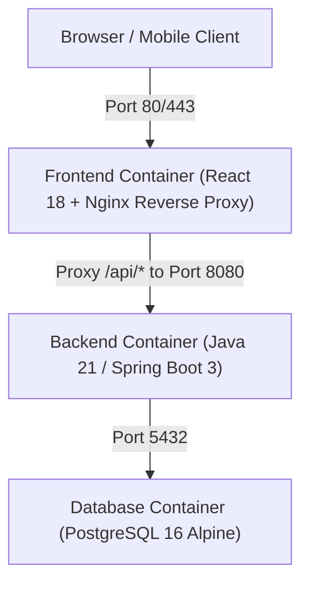
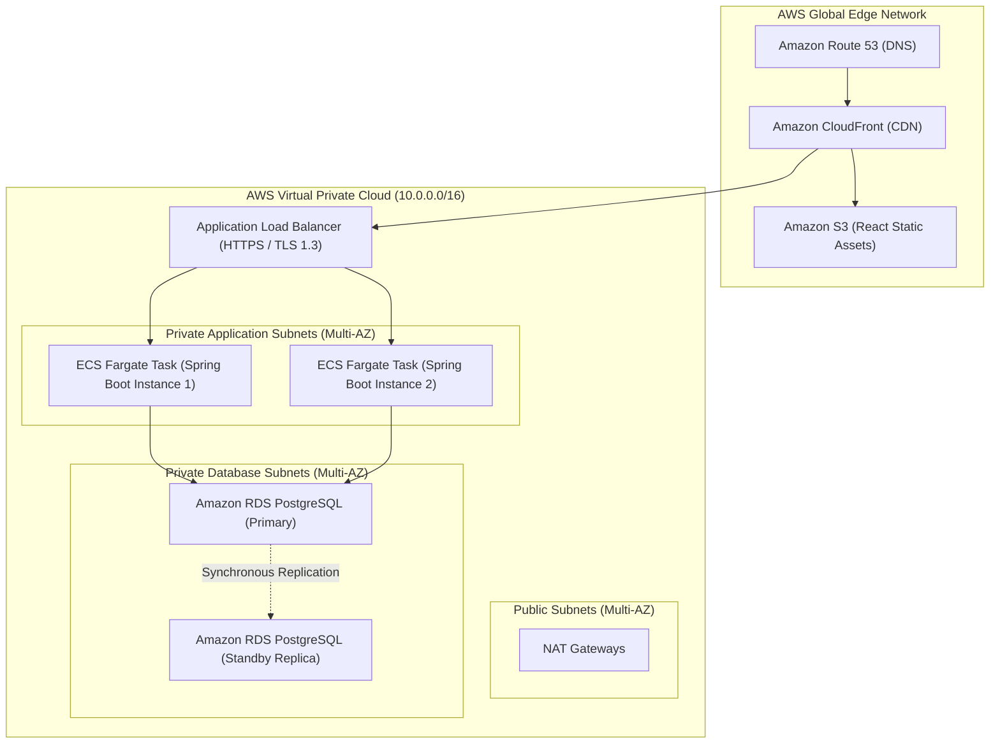

# DEPLOYMENT & DEVOPS SPECIFICATION
## Retail Inventory Management System (RIMS)
**Project Code:** `PRG_RIMS_001`  
**Target Environments:** Local Docker Compose & AWS Production Cloud  

---

## 1. Containerization Architecture

The system is fully containerized into three lightweight, production-hardened Docker containers:



---

## 2. Multi-Container `docker-compose.yml` Specification

```yaml
version: '3.8'

services:
  rims-db:
    image: postgres:16-alpine
    container_name: rims-postgres
    restart: unless-stopped
    environment:
      POSTGRES_DB: rims_db
      POSTGRES_USER: rims_user
      POSTGRES_PASSWORD: rims_secure_password_2026
    ports:
      - "5432:5432"
    volumes:
      - rims_pgdata:/var/lib/postgresql/data
      - ./backend/src/main/resources/db/migration:/docker-entrypoint-initdb.d
    healthcheck:
      test: ["CMD-SHELL", "pg_isready -U rims_user -d rims_db"]
      interval: 10s
      timeout: 5s
      retries: 5
    networks:
      - rims-network

  rims-backend:
    build:
      context: ./backend
      dockerfile: Dockerfile
    container_name: rims-backend
    restart: unless-stopped
    depends_on:
      rims-db:
        condition: service_healthy
    environment:
      SPRING_PROFILES_ACTIVE: postgres
      SPRING_DATASOURCE_URL: jdbc:postgresql://rims-db:5432/rims_db
      SPRING_DATASOURCE_USERNAME: rims_user
      SPRING_DATASOURCE_PASSWORD: rims_secure_password_2026
      JWT_SECRET: c2VjdXJlX2VudGVycHJpc2Vfand0X3NlY3JldF9rZXlfZm9yX3JpbXNfc3ByaW5nX2Jvb3RfMjAyNg==
      JWT_EXPIRATION_MS: 86400000
    ports:
      - "8080:8080"
    networks:
      - rims-network

  rims-frontend:
    build:
      context: ./frontend
      dockerfile: Dockerfile
    container_name: rims-frontend
    restart: unless-stopped
    depends_on:
      - rims-backend
    ports:
      - "80:80"
      - "3000:80"
    networks:
      - rims-network

volumes:
  rims_pgdata:
    driver: local

networks:
  rims-network:
    driver: bridge
```

---

## 3. Production Cloud Deployment: AWS Architecture



---

## 4. CI/CD Pipeline (`Jenkinsfile`)

```groovy
pipeline {
    agent any

    environment {
        DOCKER_REGISTRY = "123456789012.dkr.ecr.ap-south-1.amazonaws.com"
        IMAGE_BACKEND = "${DOCKER_REGISTRY}/rims-backend"
        IMAGE_FRONTEND = "${DOCKER_REGISTRY}/rims-frontend"
        TAG = "${BUILD_NUMBER}"
    }

    stages {
        stage('Checkout') {
            steps {
                checkout scm
            }
        }

        stage('Backend Build & Test') {
            steps {
                dir('backend') {
                    sh 'mvn clean verify'
                }
            }
            post {
                always {
                    junit 'backend/target/surefire-reports/*.xml'
                }
            }
        }

        stage('Frontend Build & Test') {
            steps {
                dir('frontend') {
                    sh 'npm ci'
                    sh 'npm test -- --watchAll=false'
                    sh 'npm run build'
                }
            }
        }

        stage('Container Image Build') {
            steps {
                sh "docker build -t ${IMAGE_BACKEND}:${TAG} -t ${IMAGE_BACKEND}:latest ./backend"
                sh "docker build -t ${IMAGE_FRONTEND}:${TAG} -t ${IMAGE_FRONTEND}:latest ./frontend"
            }
        }

        stage('Security Vulnerability Scan') {
            steps {
                sh "trivy image --severity HIGH,CRITICAL ${IMAGE_BACKEND}:${TAG}"
            }
        }

        stage('Deploy to Staging / ECS') {
            when {
                branch 'main'
            }
            steps {
                sh "aws ecs update-service --cluster rims-cluster --service rims-backend --force-new-deployment"
            }
        }
    }
}
```
